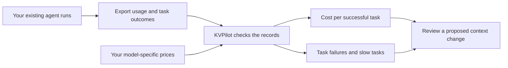
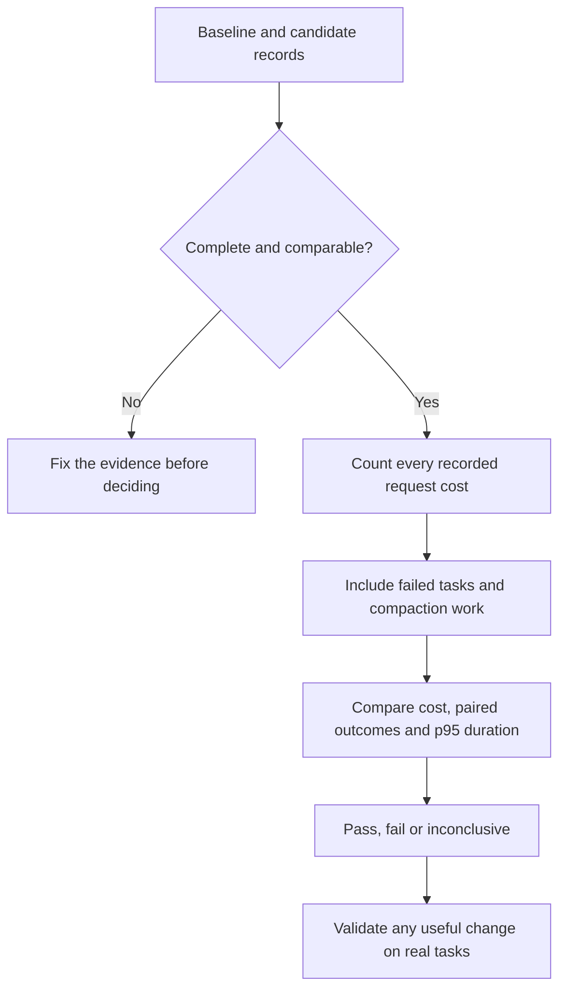

# KVPilot

**Find out whether a change to an AI agent's context actually lowers the cost of completing its work.**

KVPilot's first context-cost MVP is a local command-line tool. Give it exported request usage, task outcomes and your prices. It calculates the cost of a baseline and a changed version, checks whether the same tasks still pass, and flags worse tail latency or incomplete evidence. Tail latency means how long the slow end of the task set takes.

**This is an experiment, not a proven cost-saving product.** The included examples are synthetic, their prices are illustrative, and no customer savings have been measured. Prompt caching, context compaction and cost diagnostics already exist. Our product hypothesis is that teams will pay for a specific, tested improvement to their agent workflow.

## The problem in everyday terms

A coding agent might send a repository, its conversation and a large test log to a model repeatedly. Cached input can make repeated material cheaper to read. Removing or summarizing an old log can reduce later input, but creating the summary costs money, changes can break cache reuse, and losing a useful detail can make the task fail.

The right question is **“Did the whole task become cheaper while still succeeding?”** Counting fewer input tokens alone cannot answer it.



No GPU, model download, provider API call, mandatory proxy or raw prompt capture is needed for these commands. The tool reads local files. The first customer integration would import the customer's existing API usage records.

## Try the synthetic example

Run these commands from the repository root with Python 3.11 or later:

```bash
python3 -m venv .venv
.venv/bin/python -m pip install -e '.[dev]'

.venv/bin/kvpilot context audit \
  --trace examples/context-cost/baseline.jsonl \
  --pricing examples/context-cost/pricing.json \
  --output artifacts/context-baseline

.venv/bin/kvpilot context audit \
  --trace examples/context-cost/candidate.jsonl \
  --pricing examples/context-cost/pricing.json \
  --output artifacts/context-candidate

.venv/bin/kvpilot context compare \
  --baseline examples/context-cost/baseline.jsonl \
  --candidate examples/context-cost/candidate.jsonl \
  --pricing examples/context-cost/pricing.json \
  --min-savings-pct 10 \
  --max-p95-regression-pct 5 \
  --output artifacts/context-comparison
```

The candidate is the version you want to evaluate. The comparison checks the same task set, model, workload, evaluator and cache protocol. Its decision here requires at least 10% lower cost per successful task, no previously passing task becoming a failure, and no more than 5% worse p95 task duration. These are configurable acceptance thresholds, not promised gains.

The synthetic fixture includes a useful counterexample: `inspect-logs` becomes slightly **more expensive**, from $0.324 to $0.325, after paying for compaction. The full fixture goes from $0.7185 to $0.57 because another change saves more. These are calculations on invented usage records at illustrative rates, not measured savings. Compaction only pays for itself when enough later work becomes cheaper.

For a CI job that should fail when the comparison does not meet its gates, add `--fail-on-regression` to the comparison command. An arithmetic pass on synthetic data only tests the example; it is not evidence of a customer benefit.

You can also examine a hypothetical compaction decision:

```bash
.venv/bin/kvpilot context plan \
  --current-tokens 15000 \
  --retained-tokens 1000 \
  --future-turns 12 \
  --cache-read-usd-per-million 1 \
  --rewrite-cost-usd 0.12 \
  --summary-cost-usd 0.04 \
  --output artifacts/context-plan
```

Here `$1 per million` is an illustrative cache-read rate, **not a provider quote**. This estimate weighs future cached reads avoided against the supplied summary and rewrite costs. It cannot establish that the summary preserves useful information or that future turns will happen.

Read the [context-cost guide](docs/context-cost-guide.md) for the file format, billing assumptions, report interpretation and customer validation procedure.

## How to read a comparison



`Cost per successful task = cost of all recorded requests / number of successful tasks`.

Both failed attempts and summary-generation requests belong in the cost. A cheaper run that loses a previously passing task fails the outcome gate. p95 describes the slow end of **whole-task durations**, not the sum of API request times. A task with several parallel calls can take less time than the sum of those calls.

The supplied success labels are not independently judged by KVPilot. A complete-looking export also cannot prove its exporter included every request. Keep the original provider records, evaluator and export procedure for review.

## A small glossary

| Term | Meaning here |
| --- | --- |
| Token | A piece of text the model processes; it is not necessarily a whole word. |
| Context | The material sent to the model, such as instructions, messages, files and tool outputs. |
| Prefix | The beginning of that material. Matching prefixes can qualify for provider cache reuse. |
| Cache read | Input the provider reports serving from its prompt cache, billed using the applicable read rate. |
| Cache write | Input the provider reports creating in its prompt cache. Some providers price writes by retention period. |
| Compaction | Replacing a long history or tool output with less material, often a summary. It can cost money and lose information. |
| Successful task | A complete unit of work that passes the supplied evaluator, not merely a request that returns HTTP 200. |
| p95 task duration | A duration at or above about 95% of recorded task durations; useful for checking slow experiences. |
| KV cache | A model's saved intermediate calculations. Hosted API usage counters do not expose those tensors to this tool. |

## Built now, planned next

| Available in this MVP | Still a proposal |
| --- | --- |
| Strict local trace validation and model-specific usage pricing | Importers for customers' existing exports |
| Baseline/candidate cost, outcome and duration comparison | Identifying a customer's useful context change |
| A compaction break-even calculator | Applying a change with customer-controlled validation |
| Synthetic examples and automated regression tests | Proven customer savings and a repeatable paid offering |

This version does not rewrite prompts, summarize content, capture remote traffic or change a running agent automatically. It supports the documented Anthropic text-usage format; it does not claim to price every provider feature. Inference, tool execution and evaluation happen outside this CLI.

Provider usage multiplied by a supplied rate card is an **estimated API charge**, not an audited invoice or a measurement of GPU cost. Include retries, failures and compaction calls in the export. Other operational charges need separate accounting.

## Existing features and the product hypothesis

[Anthropic prompt caching](https://platform.claude.com/docs/en/build-with-claude/prompt-caching) and [OpenAI prompt caching](https://platform.openai.com/docs/guides/prompt-caching) already reduce the price of eligible repeated input. [LMCache CacheBlend](https://docs.lmcache.ai/kv_cache_optimizations/cacheblend.html) addresses reuse beyond a shared prefix, and [NVIDIA Dynamo](https://docs.nvidia.com/dynamo/agents/agent-simulation) already provides agent trace replay. None of these mechanisms is our claimed invention.

The proposed offer is narrower: find one costly behavior in a real workflow, test a concrete change against strong existing options, and retain the evidence when it helps or fails. A generic cost dashboard is insufficient differentiation. Willingness to pay and improvement beyond native features remain unvalidated.

## The earlier cache research remains available

KVPilot also contains a separate owned-cache research runner. Tensor engines perform model math; KVPilot owns that runner's serialization, compression, storage, admission, eviction and restoration. Adding this cost-audit CLI does not replace those implementations with a cache library.

The latest P100/RTX result was negative for the adaptive policy: it took **3.66% more time than simple admission on P100** and **0.29% more on RTX 5060 Ti** on the balanced fixture. There was no measured reduction in peak GPU allocation, and adaptive selected no lossy compression. These sequential tests establish neither customer bill savings nor serving-throughput gains.

- [Measured comparison and limitations](docs/policy-replication-2026-10-29.md)
- [Raw records and independent verification](results/policy-replication-2026-10-29/README.md)
- [P100 experiment and reproduction commands](docs/p100-admission-experiment.md)
- [Preserved earlier README and owned-cache research guide](docs/owned-cache-research.md)
- [Earlier self-hosted deployment audit proposal](docs/product-plan-2026-10-29.md), retained as a historical plan

The earlier measurements help set the standard for this MVP: keep simple baselines, count the complete work, check outcomes, and publish negative results.

## Development

```bash
.venv/bin/python -m pytest -q
```

Tests check the implementation and its fixtures. They do not establish production savings or independently verify task quality. This prototype has no project-wide open-source license selected yet; third-party notices remain with the research implementations.
