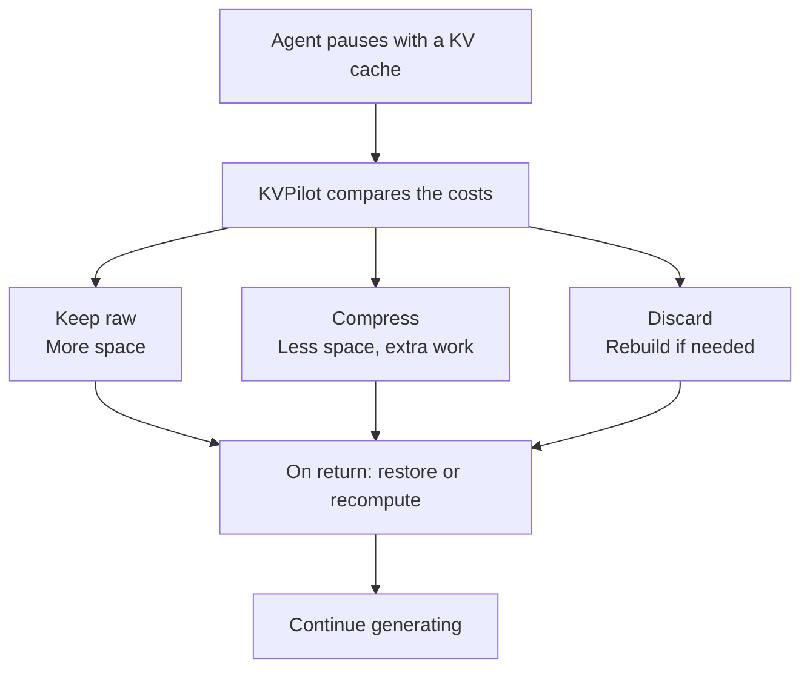
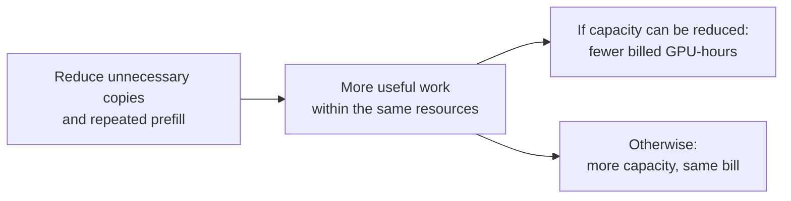
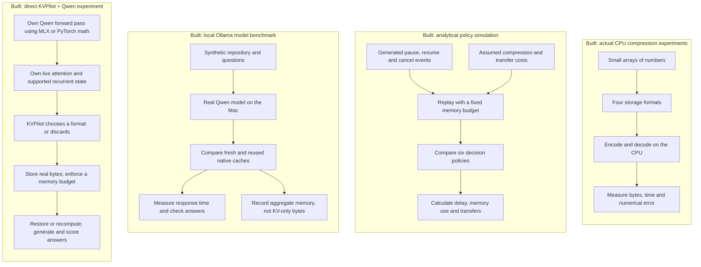
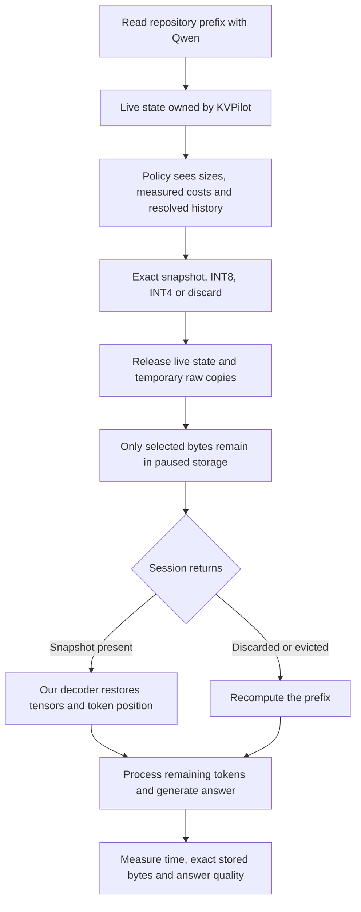
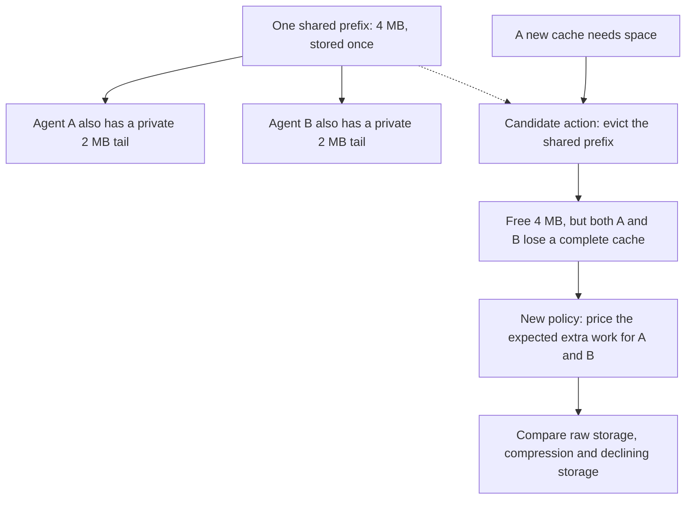
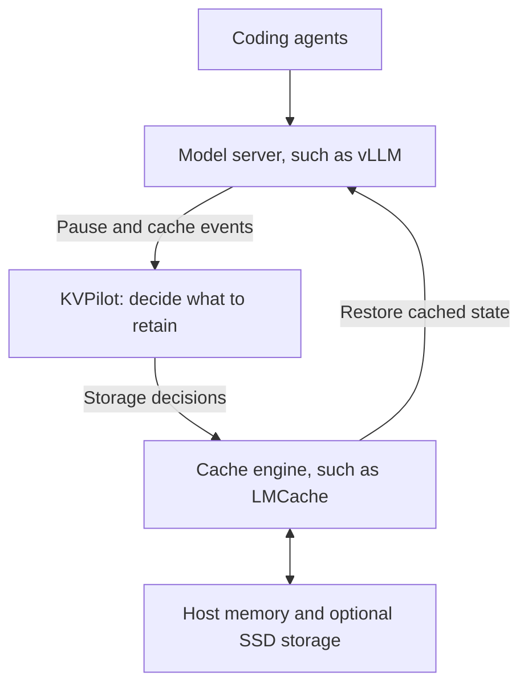

# KVPilot

**We are building software that decides what to do with an AI agent's saved calculations while it waits.**

**Today: an owned-cache research prototype tested on a Mac and a Tesla P100.** KVPilot saves, compresses, discards and restores real inference state, then continues generating. MLX or PyTorch performs tensor math; KVPilot owns live state, codecs, paused storage and eviction decisions. The runners use local model files without calling Ollama or an external cache manager.

**Latest evidence, 28 October 2026:** the P100 run contains 2,160 sessions and 24 distinct generated questions. Eviction-aware admission takes **6.4–7.9% less full-session time than always-store-native LRU in cancellation scenarios**, with identical observed outputs and approximately equal retained-cache memory. It selected only native storage or recomputation, never INT4/INT8. **No GPU-memory saving was measured**, and a simple no-eviction admission rule has the same modeled hit counts on these traces. See the [full P100 audit and raw records](docs/p100-results-2026-10-28.md) and [research-backed next experiments](docs/next-experiments.md). These are reference-runner observations, not production throughput or general quality guarantees.

## The problem, in plain English

**Next runnable experiment:** [admission baseline, equal-work timing and break-even sweep](docs/p100-admission-experiment.md).
It compares six owned policies, including a native store-only-if-space rule; separates fixed-token speed tests from free-generation quality tests; and models how cheaper codecs would change the decision.
The sweep is a counterfactual, not a new GPU speed measurement. The guide includes one offline P100 command and the exact result bundle to return.

Imagine a coding assistant reads a repository, asks a tool to run tests, and waits for the answer. While processing the code and conversation, the language model builds a **KV cache**: numbers representing intermediate calculations for earlier tokens. Reusing those numbers can avoid doing the same work again.

Now imagine hundreds of agents waiting at once. Their saved calculations compete for limited memory. Keeping everything takes space; compressing it takes work; deleting it may mean repeating work when an agent returns.

**KVPilot's job would be to choose which saved calculations deserve space, and in which format.** The goal is to make agents cheaper to run and quicker to resume within a memory budget. Those benefits still need to be demonstrated on a real serving system.

The simulator and the local Qwen experiment exercise this decision flow. Integration into a production serving system remains future work.



On return, use a complete saved copy or recompute from the input. Compressed copies need decoding first. The simulator supports shared pages; the direct local runner currently stores a separate complete snapshot for each session.

The choice uses estimates of return likelihood, encoding/transfer work, memory pressure and the cost of recomputation. It does not know the future. Approximate compression can also change model outputs, so quality must be tested before live use.

This manages **reusable calculations**, not lasting knowledge about a user. It does not train the model, change its weights, extend its context limit, or build a memristor chip. Restoring a compact cache back to full-size numbers also restores its full active memory footprint.

### How this could reduce cost

Saving a cache is useful when the future recomputation it avoids is worth the copy, storage and restoration work. Saving sessions that never return, or evicting useful state to save less useful state, can waste resources. The new admission baseline asks whether a very simple rule already avoids that waste.



We have not demonstrated lower customer bills. Sequential milliseconds are not billed GPU-seconds, and smaller saved payloads are not a measured reduction in GPU allocation. A production claim needs concurrent throughput, resource-allocation, quality and latency measurements.

OpenRouter's [provider routing](https://openrouter.ai/docs/guides/routing/provider-selection) selects among inference providers. Our current experiment manages saved state inside a self-hosted inference runtime. This is an active research and engineering area: [InferCept](https://proceedings.mlr.press/v235/abhyankar24a.html), [MORI](https://arxiv.org/abs/2606.00866), [LMCache lazy offload](https://docs.lmcache.ai/mp/lazy_offload.html) and [Dynamo agent hints](https://docs.nvidia.com/dynamo/agents/agent-hints) address related problems. Our opportunity must come from verified customer improvements, not a claim that nobody else manages agent caches.

## What we have actually built

There are four separate experiments:



The CPU experiments really execute compression code. The simulation moves descriptions of cache pages through a model of storage; it does not run a language model or transfer real KV tensors. Its cost assumptions are supplied separately, so the CPU timings are not presented as GPU performance.

The Ollama experiment runs real inference on the existing `qwen3.5:4b` model using the Mac's GPU. It measures native caching, not the simulated controller or our codecs. See the [backend capabilities and limits](docs/ollama-backend.md).

The Mac direct runner uses those model files independently. Its timings are actual local measurements of KVPilot's own cache path. It uses FP16 activations and FP32 recurrent state, so it does not claim numerical equivalence to Ollama's native runner. The attention and recurrent math follows attributed MIT reference implementations; no external cache classes are imported. The separate PyTorch runner tests dense Qwen2.5 attention state on the P100 using the same owned snapshot/store lifecycle.

| Built piece | What it means in everyday terms |
|---|---|
| Four reference codecs | Four ways to store the numbers: unchanged FP16, exact zlib compression, approximate INT8 and approximate INT4. A codec is an encoder/decoder. |
| Trace replay | A repeatable sequence of agents pausing, returning or being canceled, so policies face the same events. |
| Shared-page accounting | Two agent branches can use the same prefix. That shared data consumes physical space once. |
| Decision policies | Simple rules such as always using INT4, plus an adaptive rule that compares estimated costs. |
| Eviction-cost calculation | Before accepting a new cache, estimate the harm caused by removing existing caches to make room. |
| Evaluation harness | Freeze the code, test previously unexecuted synthetic sequences, and retain wins and losses. |
| Local real-model benchmark | Send synthetic repository questions to Ollama, time the first answer text, verify cache-hit counters and score exact answers. |
| Direct local state hooks | Export real Qwen state, encode attention tensors with our codecs, retain recurrent state exactly, delete live tensors, and restore a validated complete snapshot. |
| Owned paused-state store | Retain actual byte payloads within a capacity limit, choose formats using measured codec costs, and evict complete sessions. |

The current controller does not learn an expiry timer. Stored data leaves this replay through resume, cancellation or eviction when space is needed.

## How the real local test works



Qwen3.5 is a hybrid: eight layers have growing attention K/V tensors; 24 have recurrent and convolution state. **Fixed INT4 here means INT4 attention plus exact native recurrent state.** Both count toward stored bytes. Restored tensors return to their full active size; this prototype compresses paused state, not the attention computation itself.

We compare recomputation, serialized exact state, fixed INT4, adaptive selection without eviction pricing, and adaptive selection with eviction pricing. The two adaptive policies can select exact state, INT8, INT4 or recomputation. The [protocol](results/qwen-kvpilot-v1/protocol.json) fixes the code, calibrated costs, cases, arm order and two capacity limits before evaluating the cases. These are controlled synthetic checks on one Mac, not an unseen production workload or a GPU-server throughput claim.

**Measured verdict: the real integration works; adaptive does not win on both time and memory.** The full run contains 160 responses from eight distinct questions. Mean pause-and-resume time includes compression, restoration/recomputation and answer generation, but excludes the original prefix computation:

| Condition | Policy | Mean pause + resume | Peak paused payload |
| --- | --- | ---: | ---: |
| Roomy store | Fixed INT4 | 0.934 s | 245.14 MiB |
| Roomy store | Adaptive with eviction pricing | 0.388 s | 379.50 MiB |
| Tight store | Fixed INT4 | 1.908 s | 183.94 MiB |
| Tight store | Adaptive with eviction pricing | 2.419 s | 167.39 MiB |

All five arms got the same **7/8 unique questions correct**. INT4 changed the already-wrong arithmetic answer, so unchanged accuracy does not mean unchanged output. Full snapshots shrank about **35%** with INT4; MLX peak active allocation stayed unchanged. Exact save/restore produced byte-identical continuation logits. **351 tests plus 89 subtests pass**, and a separate validator checked all recorded rows and accounting. See [all controls, full-session timings, failures and limitations](docs/local-results.md).

## The eviction problem we fixed

**Eviction means removing cached data to make room.** The first adaptive rule asked whether storing the new cache looked cheap, but missed some of the extra work imposed on agents whose caches it displaced.

Here is a hypothetical example, not a measured benchmark. Agents A and B share 4 MB of prefix data and each has a private 2 MB tail. Total physical storage is **4 + 2 + 2 = 8 MB**, even though each agent uses 6 MB logically.



The new rule counts the shared storage once, but considers the lost benefit for both affected agents. If several pages from the same agent are removed, it charges that agent once. It then chooses among the available options; it does not guarantee that every expensive eviction will be avoided.

Our replay simplifies any incomplete cache to full recomputation. A real inference engine may reuse surviving prefixes, so this part still needs live validation. The new rule also retains the existing oldest-first victim order; it does not search for an optimal set of pages to remove.

## Where this would fit in a real product

The first intended user is a team running its own coding-agent models. KVPilot would supply decisions and explanations through existing inference/cache infrastructure. **This integration is planned, not implemented.**



We would first need to measure integration costs, connect actual lifecycle events, check cache compatibility, and test generated answers after restoring our own compressed state. Native Ollama reuse is now measured locally; a live KVPilot speedup or compression-quality result has not been demonstrated.

## What we have learned so far

The frozen evaluation ran **140 previously unseen synthetic traces containing 33,600 sessions**, through six policies. **130 tests and 89 subtests passed** before evaluation.

The new policy reduced modeled tail resume delay versus fixed INT4 in five of seven workload families. Cancellation-heavy traffic regressed, and branching was inconclusive. The two largest wins exactly matched simply keeping raw data, while using **3.76 times** the stored-byte time and transfer volume of INT4. No family met our original combined latency-and-memory target.

So we have built a working experiment and improved its decision rule. We have not yet proved that adding KVPilot makes a real model-serving system faster or cheaper. See the [full results, including regressions](docs/eviction-results.md).

## Real local model: what we measured

We ran the already installed **Ollama `qwen3.5:4b` on an M1 Pro Mac with 16 GB memory**, using its MLX GPU backend. No GPU rental or model download was needed. The main experiment used twelve synthetic repository questions, each tested twice:

| Native Ollama condition | Median time to first answer text | Correct answers |
|---|---:|---:|
| Fresh document prefix | 6.582 s | 18/24 |
| Exact repeated prompt | 0.079 s | 18/24 |
| First changed question after the document was primed | 6.567 s | 18/24 |

Exact repeats reused 99.80% of the input and gave identical answers in all 24 comparisons, including the same mistakes. The model passed nine of twelve distinct questions; this is not general coding-quality validation. Order and kernel warmup can contribute to the observed timing ratio.

A separate A/B/C diagnostic found that, after the first changed question established a checkpoint, a further new question reused a median 98.26% of the input and started answering in **0.269 s**. All twelve trios showed this pattern; nine of twelve target answers were correct. Both preceding setup requests are real work and remain in the archive.

**This measures Ollama's existing cache, not a KVPilot improvement.** Main-run aggregate allocation was 3.99–4.41 GiB; it does not isolate KV bytes or demonstrate memory savings. The installed MLX API cannot inject our codecs or policy. Read the [complete results, failures, setup costs and reproduction commands](docs/ollama-results.md), and the [backend source review](docs/ollama-backend.md).

## How this relates to existing work

CacheGen already does bandwidth-adaptive KV compression. LMCache already provides tiered storage, compression, policy extension points and lazy offload. TensorRT-LLM already compresses cold pages, and recent research already studies retention during human approval. **Neither compression nor session awareness is our claimed invention.** See the [prior-art review](docs/research.md) and [18-group source register](docs/sources.json).

The candidate product is a measurable policy and diagnostics layer on an existing engine. The [product hypothesis](docs/product-hypothesis.md) defines the first user and validation sequence. It must earn a benefit over simpler policies and existing settings; it may turn out to be an upstream contribution rather than a standalone company.

## Implementation reference

| Component | Implemented | Boundary |
|---|---|---|
| Reference codecs | FP16 framing, zlib FP16, grouped INT8, packed grouped INT4; decode, metadata and error measurement | NumPy CPU implementations; not CacheGen or TurboQuant |
| Replay | Ordered pause/resume/cancel events; finite paused-store budget; physical shared-prefix accounting; LRU eviction | Analytical, no actual tensors transferred and no concurrent resource queues |
| Policy | Raw/compressed/recompute choices; exact planned LRU victims; expected lost-cache benefit per affected owner; historical resume forecast; decision log | Greedy heuristic, no survival model, future-arrival planning or global SLO guarantee |
| Baselines | Recompute, raw retention, fixed codecs, original `adaptive`, exact-sizing zero-penalty `adaptive_exact` | `adaptive_eviction` is the candidate; these are not actual vLLM/LMCache/TensorRT benchmark arms |
| Experiments | Codec benchmark, sensitivity sweep, seven-family seeded holdout protocol, source freeze and paired whole-run bootstrap | Synthetic assumptions; new event sequences do not establish production generalization |
| Local model reference | Ollama streaming timings, cached-token counts, exact-answer checks and aggregate allocation snapshots | Native backend behavior; no KVPilot cache control, tensor capture or isolated KV-memory saving |
| Verification | Codec round trips, malformed input, isolation, shared prefixes, cancellation, capacity, early return and causal decisions | Does not establish LLM task quality or production correctness |

The policy rejects lossy profiles by default. The example explicitly enables **unvalidated lossy exploration** so we can study assumed cost tradeoffs. This flag is not quality approval.

## Run locally

Python 3.11+; Python 3.13 was used for the checked-in results. No CUDA dependency or model download is required.

```bash
python3 -m venv .venv
source .venv/bin/activate
python -m pip install -e '.[dev]'
python -m pytest -q
python scripts/make_demo_trace.py
python scripts/compare_policies.py
python scripts/sweep_policies.py
python scripts/benchmark_codecs.py --fixture gaussian --repeats 30 --output results/codecs-gaussian.json
python scripts/benchmark_codecs.py --fixture correlated --repeats 30 --output results/codecs-correlated.json
```

The [dependency snapshot](requirements-dev.lock.txt) records the local versions. To recreate it on a compatible interpreter, install that file before `pip install -e . --no-build-isolation`. Compatibility on other operating systems is untested.

Run one policy with the CLI:

```bash
kvpilot replay --trace examples/synthetic-sessions.jsonl --config examples/assumed-costs.json --policy adaptive --output results/local-adaptive.json
```

An optional `--input your-capture.npy` argument to the codec benchmark accepts a single numeric array. Record the model/layer/token/dtype provenance yourself; the program labels external input as unverified. `.npy` and `.npz` captures are excluded from Git by default.

### P100 setup and offline weights

The [owned PyTorch/P100 protocol](docs/p100-runner.md) provides a pinned CUDA
12.6 environment, an FP16 arithmetic preflight, an explicit pinned-model
download, and offline SHA256 handoff checks. The benchmark uses local weights
and KVPilot's own cache management. The [first completed P100 results](docs/p100-results-2026-10-28.md)
are now archived with the measured source revision and an independent audit.
vLLM 0.32.0 is not compatible with the P100; the
earlier RTX 3090 first/repeat ratio describes native vLLM requests, not a
KVPilot gain. See the corrected [Phase 1 provenance and limits](docs/phase1-report.md).

The new runner passed a [40-session real-model Mac smoke test](results/p100-readiness-mac-smoke-v1/report.md)
and exact restoration checks. It exposed an INT4 answer regression on one of
four questions; adaptive results still trade speed against memory. These are
Mac readiness observations, not P100 performance or quality guarantees.

## Initial evidence

The [initial findings](docs/initial-findings.md) explain the original measurements and the failed first adaptive-policy hypothesis. The CPU INT4 codec produces about **3.76×** smaller serialized data than unframed FP16 for the included 512 KiB fixtures. It is lossy; this is a byte ratio, not an inference speedup or quality result. Pre-eviction-freeze verification passed **130 tests plus 89 subtests**; the earlier native Ollama harness version passed **174 tests plus 89 subtests**. Current direct-runner validation is reported above. The [original run manifest](results/manifest.json) describes files at initial commit `d103494`, not the changed current source. The [eviction freeze](results/eviction-freeze-v1.json) binds that experiment. Cloud CI has not run.

The analytical replay's policy timings are **modeled from assumptions** in [assumed-costs.json](examples/assumed-costs.json). They do not use CPU benchmark timings as invented GPU timings. `measured_gpu_itl_ms` and `measured_llm_task_success` remain null in those replay results. The separate Ollama and direct KVPilot archives contain measured model timings and answer checks. Fully restoring a compressed cache to FP16 does not reduce its active attention footprint.

## Eviction-aware experiment

Read the [design and limits](docs/eviction-design.md), [predeclared workload protocol](examples/holdout-protocol.json), and [results](docs/eviction-results.md). `adaptive_eviction` charges the expected lost restoration benefit to each complete owner harmed by an admission, once per owner. `adaptive_exact` provides a matched sizing control with that charge disabled.

Frozen evaluation: 140 unseen synthetic traces, 33,600 sessions and six policies. Mean run-level p95 improves versus fixed INT4 in five of seven families, but cancellation-heavy traffic regresses and branching is inconclusive. Fast-return/low-pressure wins use 3.76× the stored-byte time and transfer volume and exactly match fixed raw FP16; the matched ablation attributes none of those two wins to eviction pricing. No family meets the original joint latency/memory target. Raw results, intervals and adverse secondary metrics are retained.

Run a new development archive, or reproduce the already evaluated frozen holdout:

```bash
python scripts/evaluate_eviction.py --split development --output-dir results/local-eviction-dev
python scripts/evaluate_eviction.py --split holdout --freeze-manifest results/eviction-freeze-v1.json --output-dir results/local-eviction-reproduction
```

Output directories must not already exist. The holdout command refuses source/config changes; it never silently refreshes a freeze. Rerunning the frozen experiment is reproduction, not a new unseen test. After algorithm changes, declare a new holdout and retain these results.

## Next two weeks

Follow the [14-day prototype plan](docs/prototype-plan.md), [evaluation contract](docs/evaluation.md), and [implemented trace contract](docs/implementation.md). The plan separates local preparation from later GPU validation.

1. Extend the real-state checks to longer contexts, more models and independent task suites, and measure transient process memory as well as stored payload bytes.
2. Add bounded movement/codec queues, refine eviction forecasts and compare simple TTL/static-threshold policies. Any new algorithm needs a new declared holdout after tuning on the revealed results.
3. Inspect and pin one compatible vLLM/LMCache integration, then prepare the live measurement and coding-quality protocol.
4. Publish negative cases and decide whether a GPU experiment is justified.

Later live target: at least 20% lower p95 resume first-token latency and 15% lower time-weighted stored bytes versus a strong compatible baseline, with ITL and task-quality guardrails. These are decision thresholds, not forecasts or achieved results. If a simple static policy wins, the controller has not earned its complexity.

The local numerical runner adapts MIT-licensed Apple MLX-LM mathematics; see [third-party notices](experiments/local/THIRD_PARTY_NOTICES.md). Model weights and tokenizer remain in the user's existing local installation and are not included here. This private prototype has no project-wide open-source license selected yet.
