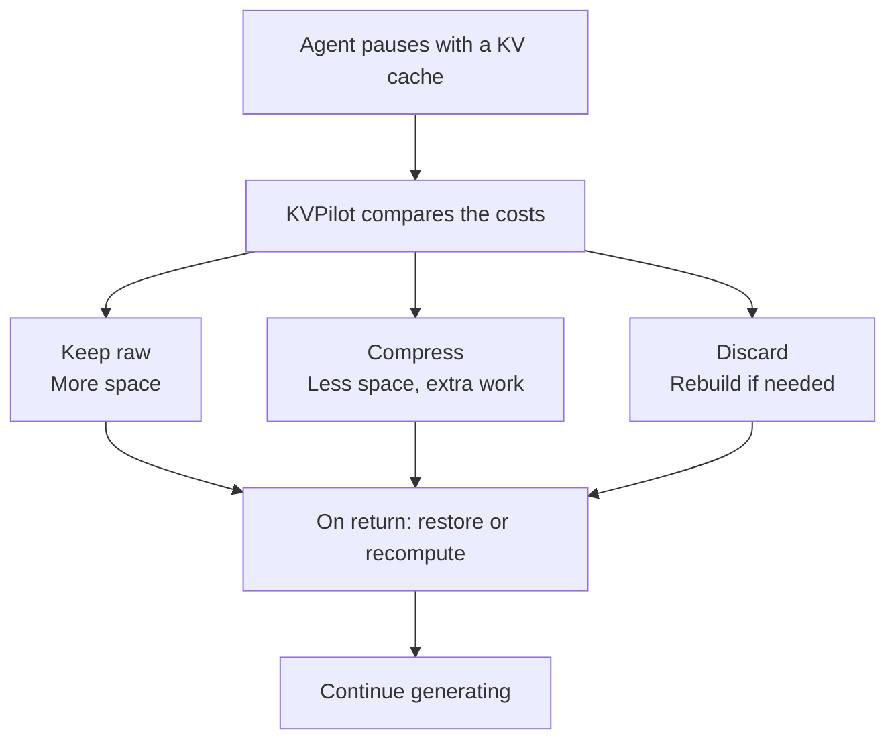
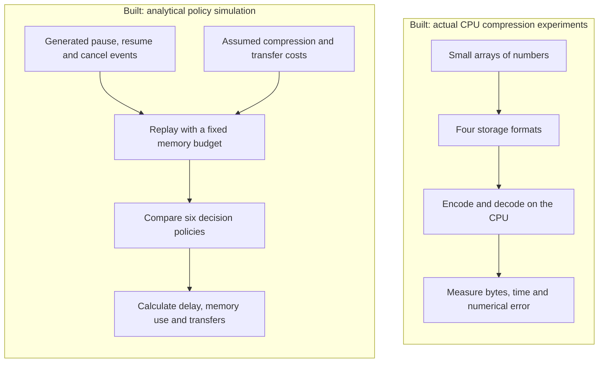
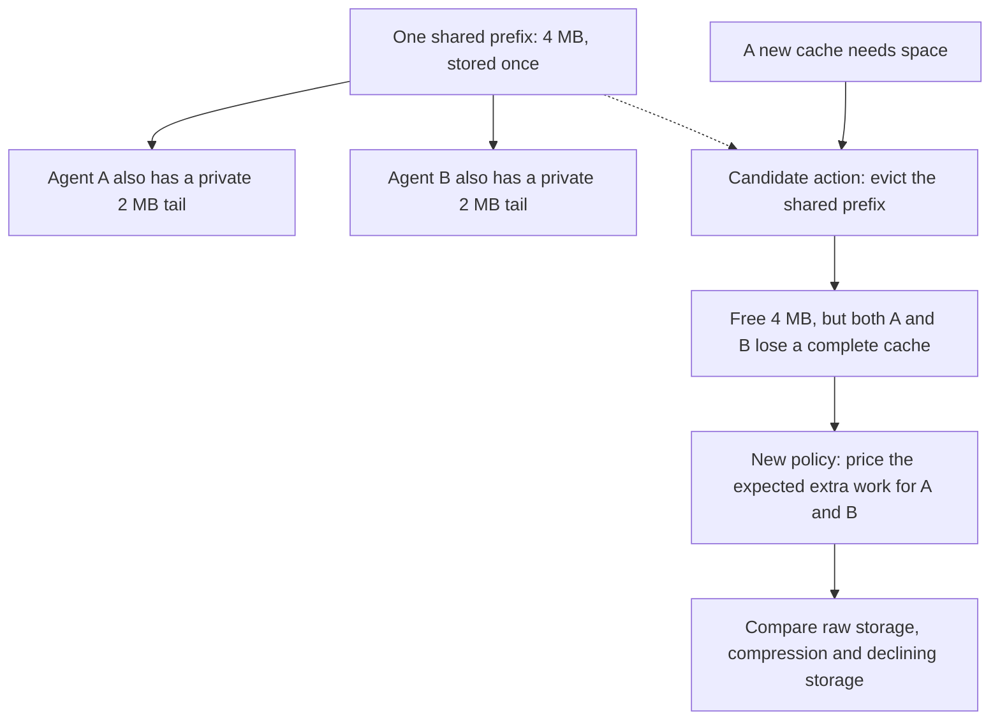
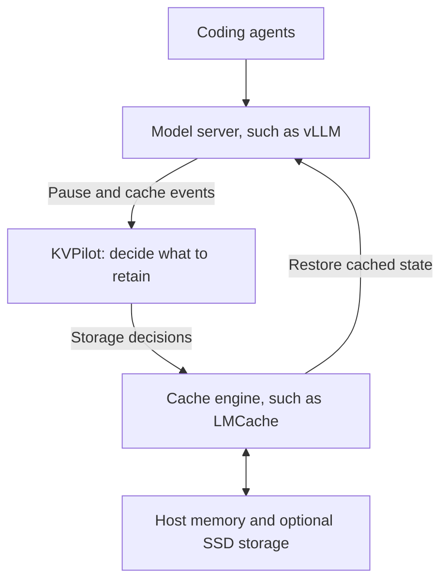

# KVPilot

**We are building software that decides what to do with an AI agent's saved calculations while it waits.**

**Today: a working local research prototype.** It contains real CPU compression experiments and a separate simulation of cache-management decisions. It is not connected to a live language model yet. The diagrams below separate what exists from the intended product.

## The problem, in plain English

Imagine a coding assistant reads a repository, asks a tool to run tests, and waits for the answer. While processing the code and conversation, the language model builds a **KV cache**: numbers representing intermediate calculations for earlier tokens. Reusing those numbers can avoid doing the same work again.

Now imagine hundreds of agents waiting at once. Their saved calculations compete for limited memory. Keeping everything takes space; compressing it takes work; deleting it may mean repeating work when an agent returns.

**KVPilot's job would be to choose which saved calculations deserve space, and in which format.** The goal is to make agents cheaper to run and quicker to resume within a memory budget. Those benefits still need to be demonstrated on a real serving system.

This is the intended decision flow. Today's simulator models these choices; the live model connection is future work.



On return, use a complete cached copy if restoring it is worthwhile; otherwise recompute from the input. Compressed copies need decoding first. Shared pages can remain for other agents, so discarding one session does not necessarily free all of its logical cache bytes.

The choice uses estimates of return likelihood, encoding/transfer work, memory pressure and the cost of recomputation. It does not know the future. Approximate compression can also change model outputs, so quality must be tested before live use.

This manages **reusable calculations**, not lasting knowledge about a user. It does not train the model, change its weights, extend its context limit, or build a memristor chip. Restoring a compact cache back to full-size numbers also restores its full active memory footprint.

## What we have actually built

There are two separate working experiments:



The CPU experiments really execute compression code. The simulation moves descriptions of cache pages through a model of storage; it does not run a language model or transfer real KV tensors. Its cost assumptions are supplied separately, so the CPU timings are not presented as GPU performance.

| Built piece | What it means in everyday terms |
|---|---|
| Four reference codecs | Four ways to store the numbers: unchanged FP16, exact zlib compression, approximate INT8 and approximate INT4. A codec is an encoder/decoder. |
| Trace replay | A repeatable sequence of agents pausing, returning or being canceled, so policies face the same events. |
| Shared-page accounting | Two agent branches can use the same prefix. That shared data consumes physical space once. |
| Decision policies | Simple rules such as always using INT4, plus an adaptive rule that compares estimated costs. |
| Eviction-cost calculation | Before accepting a new cache, estimate the harm caused by removing existing caches to make room. |
| Evaluation harness | Freeze the code, test previously unexecuted synthetic sequences, and retain wins and losses. |

The current controller does not learn an expiry timer. Stored data leaves this replay through resume, cancellation or eviction when space is needed.

## The eviction problem we fixed

**Eviction means removing cached data to make room.** The first adaptive rule asked whether storing the new cache looked cheap, but missed some of the extra work imposed on agents whose caches it displaced.

Here is a hypothetical example, not a measured benchmark. Agents A and B share 4 MB of prefix data and each has a private 2 MB tail. Total physical storage is **4 + 2 + 2 = 8 MB**, even though each agent uses 6 MB logically.



The new rule counts the shared storage once, but considers the lost benefit for both affected agents. If several pages from the same agent are removed, it charges that agent once. It then chooses among the available options; it does not guarantee that every expensive eviction will be avoided.

Our replay simplifies any incomplete cache to full recomputation. A real inference engine may reuse surviving prefixes, so this part still needs live validation. The new rule also retains the existing oldest-first victim order; it does not search for an optimal set of pages to remove.

## Where this would fit in a real product

The first intended user is a team running its own coding-agent models. KVPilot would supply decisions and explanations through existing inference/cache infrastructure. **This integration is planned, not implemented.**



We would first need to measure real costs, connect actual lifecycle events, check cache compatibility, and test generated answers. No GPU integration, live serving speedup or preserved coding accuracy has been demonstrated yet.

## What we have learned so far

The frozen evaluation ran **140 previously unseen synthetic traces containing 33,600 sessions**, through six policies. **130 tests and 89 subtests passed** before evaluation.

The new policy reduced modeled tail resume delay versus fixed INT4 in five of seven workload families. Cancellation-heavy traffic regressed, and branching was inconclusive. The two largest wins exactly matched simply keeping raw data, while using **3.76 times** the stored-byte time and transfer volume of INT4. No family met our original combined latency-and-memory target.

So we have built a working experiment and improved its decision rule. We have not yet proved that adding KVPilot makes a real model-serving system faster or cheaper. See the [full results, including regressions](docs/eviction-results.md).

## How this relates to existing work

CacheGen already does bandwidth-adaptive KV compression. LMCache already provides tiered storage, compression, policy extension points and lazy offload. TensorRT-LLM already compresses cold pages, and recent research already studies retention during human approval. **Neither compression nor session awareness is our claimed invention.** See the [prior-art review](docs/research.md) and [18-group source register](docs/sources.json).

The candidate product is a measurable policy and diagnostics layer on an existing engine. The [product hypothesis](docs/product-hypothesis.md) defines the first user and validation sequence. It must earn a benefit over simpler policies and existing settings; it may turn out to be an upstream contribution rather than a standalone company.

## Implementation reference

| Component | Implemented | Boundary |
|---|---|---|
| Reference codecs | FP16 framing, zlib FP16, grouped INT8, packed grouped INT4; decode, metadata and error measurement | NumPy CPU implementations; not CacheGen or TurboQuant |
| Replay | Ordered pause/resume/cancel events; finite paused-store budget; physical shared-prefix accounting; LRU eviction | Analytical, no actual tensors transferred and no concurrent resource queues |
| Policy | Raw/compressed/recompute choices; exact planned LRU victims; expected lost-cache benefit per affected owner; historical resume forecast; decision log | Greedy heuristic, no survival model, future-arrival planning or global SLO guarantee |
| Baselines | Recompute, raw retention, fixed codecs, original `adaptive`, exact-sizing zero-penalty `adaptive_exact` | `adaptive_eviction` is the candidate; these are not actual vLLM/LMCache/TensorRT benchmark arms |
| Experiments | Codec benchmark, sensitivity sweep, seven-family seeded holdout protocol, source freeze and paired whole-run bootstrap | Synthetic assumptions; new event sequences do not establish production generalization |
| Verification | Codec round trips, malformed input, isolation, shared prefixes, cancellation, capacity, early return and causal decisions | Does not establish LLM task quality or production correctness |

The policy rejects lossy profiles by default. The example explicitly enables **unvalidated lossy exploration** so we can study assumed cost tradeoffs. This flag is not quality approval.

## Run locally

Python 3.11+; Python 3.13 was used for the checked-in results. No CUDA dependency or model download is required.

```bash
python3 -m venv .venv
source .venv/bin/activate
python -m pip install -e '.[dev]'
python -m pytest -q
python scripts/make_demo_trace.py
python scripts/compare_policies.py
python scripts/sweep_policies.py
python scripts/benchmark_codecs.py --fixture gaussian --repeats 30 --output results/codecs-gaussian.json
python scripts/benchmark_codecs.py --fixture correlated --repeats 30 --output results/codecs-correlated.json
```

The [dependency snapshot](requirements-dev.lock.txt) records the local versions. To recreate it on a compatible interpreter, install that file before `pip install -e . --no-build-isolation`. Compatibility on other operating systems is untested.

Run one policy with the CLI:

```bash
kvpilot replay --trace examples/synthetic-sessions.jsonl --config examples/assumed-costs.json --policy adaptive --output results/local-adaptive.json
```

An optional `--input your-capture.npy` argument to the codec benchmark accepts a single numeric array. Record the model/layer/token/dtype provenance yourself; the program labels external input as unverified. `.npy` and `.npz` captures are excluded from Git by default.

## Initial evidence

The [initial findings](docs/initial-findings.md) explain the original measurements and the failed first adaptive-policy hypothesis. The CPU INT4 codec produces about **3.76×** smaller serialized data than unframed FP16 for the included 512 KiB fixtures. It is lossy; this is a byte ratio, not an inference speedup or quality result. Current local verification passed **130 tests plus 89 subtests**. The [original run manifest](results/manifest.json) describes files at initial commit `d103494`, not the changed current source. The [eviction freeze](results/eviction-freeze-v1.json) binds the new experiment. Cloud CI has not run.

All policy timings are **modeled from assumptions** in [assumed-costs.json](examples/assumed-costs.json). They do not use the CPU benchmark timings as invented GPU timings. `measured_gpu_itl_ms` and `measured_llm_task_success` remain null. Fully restoring a compressed cache to FP16 does not reduce its active attention footprint.

## Eviction-aware experiment

Read the [design and limits](docs/eviction-design.md), [predeclared workload protocol](examples/holdout-protocol.json), and [results](docs/eviction-results.md). `adaptive_eviction` charges the expected lost restoration benefit to each complete owner harmed by an admission, once per owner. `adaptive_exact` provides a matched sizing control with that charge disabled.

Frozen evaluation: 140 unseen synthetic traces, 33,600 sessions and six policies. Mean run-level p95 improves versus fixed INT4 in five of seven families, but cancellation-heavy traffic regresses and branching is inconclusive. Fast-return/low-pressure wins use 3.76× the stored-byte time and transfer volume and exactly match fixed raw FP16; the matched ablation attributes none of those two wins to eviction pricing. No family meets the original joint latency/memory target. Raw results, intervals and adverse secondary metrics are retained.

Run a new development archive, or reproduce the already evaluated frozen holdout:

```bash
python scripts/evaluate_eviction.py --split development --output-dir results/local-eviction-dev
python scripts/evaluate_eviction.py --split holdout --freeze-manifest results/eviction-freeze-v1.json --output-dir results/local-eviction-reproduction
```

Output directories must not already exist. The holdout command refuses source/config changes; it never silently refreshes a freeze. Rerunning the frozen experiment is reproduction, not a new unseen test. After algorithm changes, declare a new holdout and retain these results.

## Next two weeks

Follow the [14-day prototype plan](docs/prototype-plan.md), [evaluation contract](docs/evaluation.md), and [implemented trace contract](docs/implementation.md). The plan separates local preparation from later GPU validation.

1. Validate accounting and profile codecs on a wider range of inputs, including actual KV captures when available.
2. Add bounded movement/codec queues, refine eviction forecasts and compare simple TTL/static-threshold policies. Any new algorithm needs a new declared holdout after tuning on the revealed results.
3. Inspect and pin one compatible vLLM/LMCache integration, then prepare the live measurement and coding-quality protocol.
4. Publish negative cases and decide whether a GPU experiment is justified.

Later live target: at least 20% lower p95 resume first-token latency and 15% lower time-weighted stored bytes versus a strong compatible baseline, with ITL and task-quality guardrails. These are decision thresholds, not forecasts or achieved results. If a simple static policy wins, the controller has not earned its complexity.

No external implementation code was copied. This private prototype has no open-source license selected yet.
